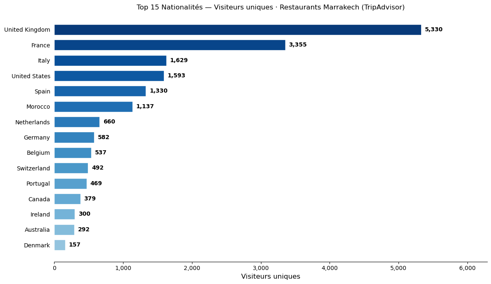

# TripAdvisor Marrakech — Restaurant Scraping & Visitor Nationalities

[](https://www.python.org/)
[](https://jupyter.org/)
[](https://www.crummy.com/software/BeautifulSoup/)

Web scraping project targeting **TripAdvisor**, focused on the restaurants of **Marrakech**. The pipeline collects the **Top 500 restaurants**, extracts **all their reviews** plus each reviewer's **location**, and ranks the **nationalities** of the visitors.

---

## 📂 Contents

```
TripAdvisor/
├── partie_A.ipynb    # Part A : collect the Top 500 restaurants
├── partie_B.ipynb    # Part B : reviews, locations & nationalities
├── output.png        # Chart: Top 15 visitor nationalities
└── README.md
```

---

## ⚙️ How it works

### Part A — Top 500 restaurants

- **Rotating User-Agent** on every request, enriched headers
- **`safe_request()`** — infinite retry loop with **progressive backoff** (60 s → 300 s) on `403` / `429`
- **Pagination** via `oa{offset}` (30 restaurants per page)
- **Checkpoints** in `restaurants_marrakech_partial.json` → automatic resume on restart
- Final export: `top_500_restaurants.json` / `.csv`

### Part B — Reviews & nationalities

- **Persistent session** with real cookies, renewed every 50 requests
- **Review pagination** via `or{offset}` (15 reviews per page)
- Locations are read **directly on the review page** — no extra requests to user profiles
- **Regex filter** removes false positives (badges, contribution counts, levels)
- `normalize_country()` → country → continent, then ranking by unique visitors

---

## 📊 Key Results

| Indicator | Value |
|---|---|
| Restaurants detected | **1 781** |
| Restaurants in the Top 500 | **500** |
| Reviews collected | **58 091** |
| Unique user profiles | **54 281** |
| With a location | **20 472** (37.7 %) |
| Countries detected | **149** |

**Top nationalities** (unique visitors) :
🇬🇧 United Kingdom (5 330) · 🇫🇷 France (3 355) · 🇮🇹 Italy (1 629) · 🇺🇸 United States (1 593) · 🇪🇸 Spain (1 330)

<p align="center">
  
</p>

---

## ▶️ Run

```bash
pip install requests beautifulsoup4 fake_useragent pandas pycountry pycountry-convert

jupyter notebook partie_A.ipynb    # Top 500 restaurants
jupyter notebook partie_B.ipynb    # reviews + nationalities (long)
```

Both notebooks resume automatically from their JSON checkpoints — if interrupted, just relaunch them.

---

